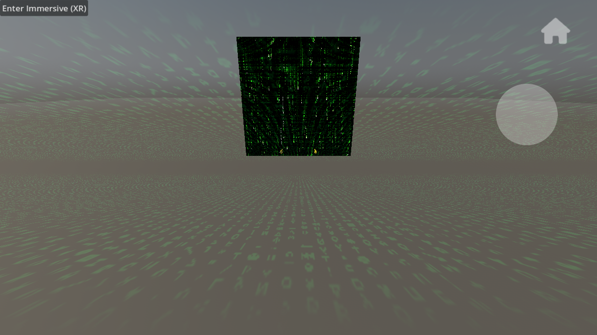
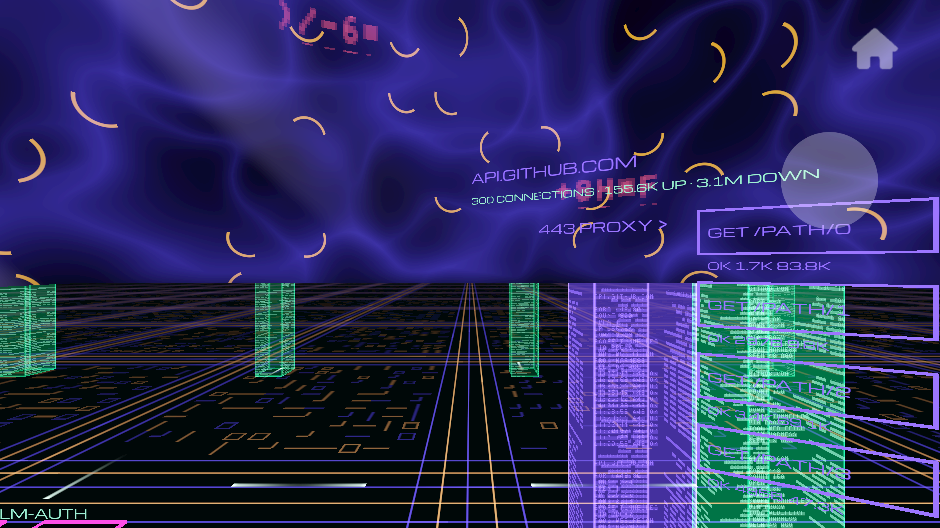

# styx-godot

An engine to visualize and interact with network traffic data in Augmented and Virtual Reality

<div style="text-align:center;">
  
</div>

In Greek mythology the River Styx was the boundary between the world of the living and Hades

The Styx project provides a boundary between your devices and the Underworld of the Internet

<div style="text-align:center;">
  
  <p style="font-size: 0.8em; color: gray; margin-top: 5px;">
    "Matrix" style visualizer for recent network activity by domain
  </p>
</div>

## Features
- Augmented Reality live pass-through support
- Virtual Reality native support for Meta Quest, SteamVR, and OpenXR headsets
- Apple Vision Pro native support for visionOS
- WebXR support for installation-free use with walled-garden devices
- "Teleport" locomotion for AR/VR/XR environments
- On-screen Joystick Touch Pad support for mobile and tablet devices

## Platforms
- Apple Vision Pro
- Meta Quest 3, 3s, and 2
- SteamVR and OpenXR headsets (such as Valve Index)
- WebXR supported devices
- Android
- iPhone and iPad

## Dependencies

### Network Access Point
- [styx-os](https://github.com/Jigsaw-Studio/styx-os) on a Raspberry Pi 3, 4, or 5

### Apple Vision Pro
- Reference: [GodotVision](https://godot.vision/)
- Requires updates from Godot 4.2 to 4.3
- Download Godot 4.3 version of modules:
    ```
    git clone git@github.com:kevinw/GodotVision.git
    git clone git@github.com:multijam/SwiftGodot.git
    git clone git@github.com:multijam/SwiftGodotKit.git
    ```
- Download Godot 4.3 version of [libgodot.xcframework.zip](https://github.com/multijam/SwiftGodot/releases/download/4.3.0/libgodot.xcframework.zip)
- Extract `libgodot.xcframework` and place into `SwiftGodot` root directory from git repository (this prevents a later error during import that local binary targets `libgodot_tests` and `binary_libgodot` at the `SwiftGodot/libgodot.xcframework` location "does not contain a binary artifact.")
- Open `GodotProject/project.godot` once in Godot 4.3 editor to automatically import assets
- Open `Styx.xcodeproj` Xcode project in Xcode 16.2
- Build and Run on visionOS simulator or install to Apple Vision Pro (will require adding App Store Team ID)

### Meta Quest and Android devices
- Follow the standard Godot [Deploying to Android](https://docs.godotengine.org/en/stable/tutorials/xr/deploying_to_android.html) guide

### WebXR
- Reference: Godot [Exporting for the Web](https://docs.godotengine.org/en/stable/tutorials/export/exporting_for_web.html) guide
- Generate a Web Export to a build directory with name `index.html`
- Transfer all files from build directory to [styx-os](https://github.com/Jigsaw-Studio/styx-os) at path `/srv/styx-web/html`
- Example all-in-one command on macOS:
    ```
    /Applications/Godot\ 4.3.app/Contents/MacOS/Godot \
  	  --path $HOME/styx-godot/Godot_Project \
  	  --headless \
  	  --export-release "Web" \
            $HOME/styx-godot/Godot_Project/build/html/index.html \
    && rsync --delete -zvaP \
        $HOME/styx-godot/Godot_Project/build/html/* \
        172.16.100.1:/srv/styx-web/html
    ```

### Using Layman as the data source
[Layman](https://github.com/castellotti/layman) can feed this app the destinations an AI coding agent reached, in the same shape as a Styx Pi. Its Styx extension serves `GET /api/styx/v1/matrix`; Layman's own docs (`docs/extensions/styx.md` in that repository) describe that side.

Point the app at it, on the command line (arguments go after `--`) or, for the web export, in the page's query string:

| Native argument | Web query | Meaning |
|---|---|---|
| `--api=http://host:8880/api/styx` | `?api=/api/styx` | Base URL of the feed (`http(s)://` only; on the web only a path such as `/api/styx`, on the page's own origin). Also read from the `STYX_API_URL` environment variable. Unset: the Pi, as before |
| `--session=<id>` | `&session=<id>` | One Layman session (`A-Z a-z 0-9 _ -`, up to 128 characters) |
| `--relative=15m` | `&relative=15m` | How far back to look (`60s`, `15m`, `1h`, `1d`) |
| `--poll=2` | `&poll=2` | Every N seconds (1 to 60) also ask for destinations not yet shown and add them at once (the Matrix; off by default). Gibson asks for the whole city again every N seconds, or every 30 when this is not set |
| | `&embed=1` | On black, no interface, no keys: for an iframe. The Matrix has a fixed camera; Gibson tours by itself, and dragging and the wheel still move it |
| `--viz=gibson` | `&viz=gibson` | Show the Gibson city instead of the Matrix (default `matrix`) |
| `--select=<host>` | `&select=<host>` | Gibson: select this host's tower as soon as it exists (lower-case letters, digits and `. _ : [ ] / -`, up to 255) |
| `--scheme=state` | `&scheme=state` | Gibson's colours: `state` (default), `green`, `cyan`, `red`, `night` |
| `--shot=/abs/path.png` | | Native only: save one frame to this PNG and quit (check a picture without a person) |
| `--shot-after=6` | | Seconds before `--shot` is taken (1 to 120) |

Values that do not match are ignored. For the Layman tab, export with the **Web (Layman)** preset (no third-party scripts, no threads, so it works in an iframe):
```
Godot --path Godot_Project --headless --export-release "Web (Layman)" build/layman/index.html
```


### Gibson
A second view, after the "city of text" sequences of a 1995 film: a city of translucent towers on a circuit-board ground, under a slow sky of filaments and formulas.

- **Towers**: one per remote host. The more data, the taller; the more connections, the wider. Rows of real text (host, ports, counts, bytes) cover the faces and turn into bars from far away. A tower is green when normal, red when every connection was refused (a partly refused one has a red cap), amber when outside the tunnel, cyan when local; one that appears now rises, pale, for a few seconds.
- **Blocks**: hosts of one registrable domain stand together on a block of up to 16 lots, and a tower keeps its lot as the data changes. The busiest domains are nearest the centre. The local side is the low chip at the centre with the magenta rim (amber in Night).
- **Streaks**: light racing along the streets between the home chip and a tower. Gibson reads `/api/v1/hosts`, `/api/v1/links` and (for a selected tower) `/api/v1/flows` when the server has them: one home chip per source of the links, one route per link, and a tower is dimmer the longer ago it was reached. When the first `/api/v1/hosts` request fails (a Pi that was not updated, any server without it) it reads the Matrix feed (`/api/v1/matrix`) instead, as before: one home chip, every host equally recent, and no log to select.

```
Godot --path Godot_Project -- --viz=gibson --api=http://localhost:8880/api/styx
```
or `?viz=gibson` on the web export. `C` cycles the colour schemes (green, cyan, red and night show state as marks: stripes for refused, dashes for outside the tunnel). The camera tours the city by itself; any input takes over: `W A S D` fly along the view, the arrows turn and tilt it, `Page Up` / `Page Down` go up and down, `Space` held is three times faster, `Home` returns overhead, dragging with the left button looks, the wheel moves along the view, and the on-screen stick and pad work on touch. Clicking a tower (a click, not a drag) selects it: it turns the scheme's highlight colour, the camera flies to 9 units from its nearest face, its faces carry its log (`HH:MM:SS <PORT> <STATE>`, newest first) and a menu stands in front of it: the log grouped by port and via (right-aligned, `Up` / `Down` or a click picks one), and beside the picked group its newest four rows as boxes (`GET /PATH` and `OK 1.7K 83.8K`; a refused row is red with `REFUSED <RULE>`). `Escape` or a click on empty space deselects. The tour does not resume while a tower is selected. In XR the city is a table-top model. The visionOS build keeps the bar charts. At most 160 towers are drawn.



`window.styxViews` on the web page lists the views a build has (`['matrix', 'gibson']`), which Layman reads.

### iOS and iPadOS
- Reference: Godot [Exporting for iOS](https://docs.godotengine.org/en/stable/tutorials/export/exporting_for_ios.html) guide
- In most cases the default settings for exporting to iOS should be sufficient

## Credits
- Gibson's labels use [Michroma](https://fonts.google.com/specimen/Michroma) by Vernon Adams, under the SIL Open Font Licence ([`assets/fonts/OFL.txt`](Godot_Project/assets/fonts/OFL.txt))
- Godot XR Tools: [Website](https://godotvr.github.io/godot-xr-tools/), [GitHub](https://github.com/GodotVR/godot-xr-tools) (special thanks [Bastiaan Olij](https://github.com/BastiaanOlij))
- [GodotVision](https://godot.vision/) (special thanks [Kevin Watters](https://github.com/kevinw))
- [Pocket Godot](https://github.com/lukky-nl/Pocket-Godot) (special thanks [@lukky-nl](https://github.com/lukky-nl))
- David Snopek's [How to make a VR game for WebXR with Godot 4](https://www.snopekgames.com/tutorial/2023/how-make-vr-game-webxr-godot-4)
